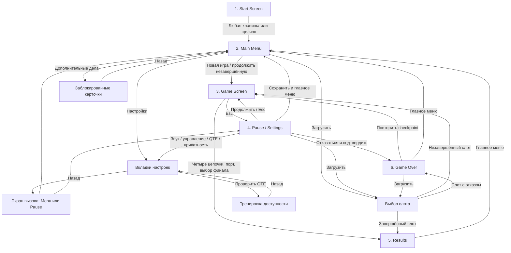

# Лабораторная работа №9 — интерактивный UI/UX-прототип

Прототип реализован непосредственно в Pygame. Это действующие Scene-классы, а не набор изображений. Шесть основных экранов: Start, Main Menu, Game, Pause / Settings, Results, Game Over. Загрузка, DLC, диалоги согласия и тренировка QTE — вспомогательные экраны.

## Схема переходов

При «Продолжить» сохранённый финал открывает Results либо Game Over. Закрытие любого вспомогательного экрана через Esc возвращает предыдущий экземпляр сцены; Esc в корневом меню/финале не закрывает приложение. Пустые слоты, Continue без файла и retry без исправной точки отключены и имеют текстовое объяснение.

## Мир и персонажи

Астера, 2035 год: дождливый город неонуара. События связаны с убийством Константина Левицкого, делом родителей Никиты 2020 года и системой «Сигма» Helios Systems. Пять существующих узлов — участок, квартира, архив, метро и офис/порт — сохранены. Улики и текущие правила доказательств не заменены.

Никита Волков — 27-летний детектив, переживший гибель Марины и Павла. Его палитра — холодный плащ и красные акценты. N.U.R.S. — цифровой женский аватар и аналитический напарник; голубой подчёркивает её интерфейс. Портреты взяты из предоставленного GCD. Соколов назначает трёхдневный срок, Анна служит источником, Вейр появляется в финальной доказательной цепочке.

Никита в исследовании имеет временные состояния idle/walk/interaction. Карты, спрайты NPC и интерьеры остаются временными материалами предыдущего этапа. Новые названия DLC — предварительные идеи каталога, не утверждённые продолжения канона.

## Визуальная система

| Элемент | Решение |
|---|---|
| Основа | 1280×720, масштабирование с полями, поддержка 1920×1080 |
| Фон | #090F1B, панели #111C2C |
| Действие / аналитика | Голубой #5AD6E2 |
| Угроза / поражение | Красный #DA4558 и текстовая подпись |
| Типографика | Пиксельная растеризация логотипов и метрик; Tahoma/резервные шрифты для длинного кириллического текста |
| Кнопки | Контрастная рамка, подсветка hover, видимый клавиатурный фокус |
| Звук | Собственные синтезированные короткие PCM-тоны; громкость 0–100% |
| Переход | Fade появления 0,22 с; без блокировки действий; можно отключить |
| Дождь | Движение в Start/Main Menu и окнах мира; уменьшение анимации делает его статичным |

## Экраны и действия

1. **Start**: логотип, слоган, город, дождь и «Нажмите любую клавишу». Автоматического пропуска нет.
2. **Main Menu**: Новая игра (подтверждает замену auto/checkpoint), Продолжить (автослот), Загрузить (выбор), Настройки (вкладки), Дополнительные дела (информация), Выход (корректное завершение).
3. **Game**: существующие Exploration/Investigation с HUD дня, улик и здоровья. Индикатор отражает GameState; боевой/ресурсный цикл не добавлен. Время учитывает игровые окна, но не служебные меню.
4. **Pause / Settings**: пауза содержит все десять запрошенных действий и дополнительный отказ от дела. Настройки разделены на звук, управление, QTE/экран и приватность. Значения сохраняются сразу. Сенсоры явно обозначены как не реализованные; согласие не запускает их.
5. **Results**: название выбранного исхода, сюжетный итог, улики, правильные выводы, репутация, время HH:MM:SS и Главное меню. Счётчик выводов сверяет flags с необходимыми уликами.
6. **Game Over**: в текущем прототипе единственная реальная причина — подтверждённый отказ от расследования. Повтор восстанавливает checkpoint; загрузка открывает список; Главное меню возвращает в меню. Смерть и отстранение не имитируются.

## Сохранения и предотвращение ошибок

`saves/slot1.json` — автосохранение; `slot1_manual.json` — отдельный ручной слот; `slot1_checkpoint.json` — начало нового расследования, вход в локацию или восстановленная незавершённая игра. Game Over и Results не заменяют checkpoint. Загрузка заменяет текущий несохранённый прогресс, о чём предупреждает экран выбора. `settings.json` содержит параметры интерфейса, а не прогресс. Ошибки файлов выводятся сообщением, а исправные слоты остаются доступны. Сохранение v1 мигрирует в памяти с play_seconds=0.

## Демонстрационный маршрут внутри игры

Запустите `run.bat`, нажмите клавишу, посетите Настройки и Дополнительные дела, вернитесь и начните игру. Проверьте HUD, E у терминала, Esc и все действия паузы. В настройках QTE запустите тренировку: A → D → Space; повторите без таймера. Откройте приватность, отмените диалог согласия и убедитесь, что состояние осталось выключенным.

Для Game Over: Esc → Отказаться от дела → Подтвердить → Повторить с контрольной точки. Для Results: соберите все материалы по маршруту участок → квартира → архив → метро → порт; N → «сравни следы»; доска в порту → финальное решение. Нельзя открыть успешный итог одной демонстрационной кнопкой без доказательств.

Автоматический вариант маршрута реализован в `tests/test_lab09.py`: тесты отправляют события мыши/клавиш, проверяют типы сцен и состояние. Они не заменяют оценку удобства реальными пользователями.

## Файлы реализации

- `src/scenes/menu.py`: Start, Menu, Pause и подтверждение новой игры.
- `src/scenes/settings.py`: настройки, загрузка, DLC, тренировка QTE.
- `src/scenes/results.py`: Results, GameOver, формат времени.
- `src/scenes/overlays.py`: сохранённое имя Ending наследует Results; переход из FinalChoice сохраняется.
- `src/systems/settings.py`, `audio.py`: локальные настройки и звук UI.
- `src/core/game.py`: слоты, fullscreen, таймер и fade; существующий SceneManager не заменён.
- `src/ui/widgets.py`, `src/scenes/base.py`: пиксельный текст, hover, фокус, общий отклик кнопок.
