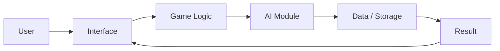
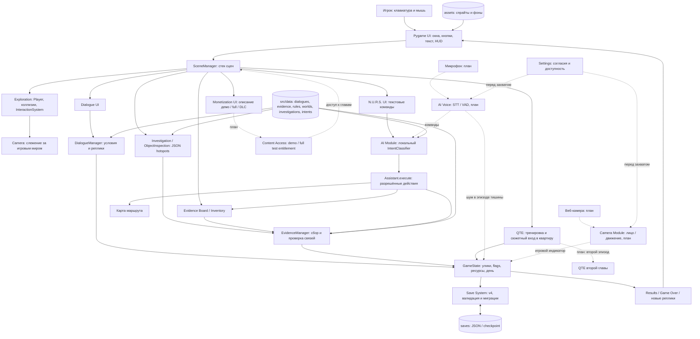

# Архитектура Bloody Trail

Срез v0.4 после MVP 1 / ЛР11. Существующая архитектура сохраняется. Сплошные связи — текущий поток; пунктир и подпись «план» — будущая интеграция. Высокоуровневая цепочка ниже показывает цикл интеллектуального действия: обычное перемещение не требует AI.

## Компоненты и границы

| Компонент | Реальный файл / планируемая граница | Контракт |
|---|---|---|
| Pygame UI | `src/ui/widgets.py`, `src/scenes/` | Логические координаты 1280×720, масштабирование ввода; UI не подтверждает улику самостоятельно |
| SceneManager | `src/core/scene_manager.py` | push/pop/replace; Investigation возвращает прежний Exploration |
| DialogueManager | `src/systems/dialogue.py` | JSON + evidence_ids/flags → доступные реплики |
| EvidenceManager | `src/systems/evidence.py` | collect/propose/evaluate; требуется полный набор оснований, повторный сбор без награды |
| QTE | `src/scenes/settings.py`, `src/scenes/qte.py` | Практика и один сюжетный эпизод: таймер, здоровье, checkpoint; второй планируется BT-17 |
| AI Voice | Новая граница в `src/ai/`, BT-25/26 | PCM → текст → существующий IntentClassifier; VAD → ограниченный игровой сигнал |
| Camera Module | Новая граница в `src/ai/`, BT-27 | Кадр → наличие лица/движение → игровой индикатор; не детектор лжи |
| Save System | `src/systems/save.py` | Проверка версии, конечных чисел и доказательств до bind_state; атомарная замена JSON |
| Monetization / Content Access | UI `src/scenes/menu.py`; проверка доступа планируется BT-31 | Карточки пока заблокированы; будущий тестовый entitlement не является оплатой/DRM |

N.U.R.S. помогает проверять правила, но не создаёт доказательства из текста команды. Будущие сенсоры передают результат через тот же слой логики и не записывают flags напрямую. При загрузке не возобновлять захват автоматически. Клавиатурные альтернативы должны использовать те же игровые последствия. Сеть и внешние AI-сервисы не входят в обязательный путь запуска.
