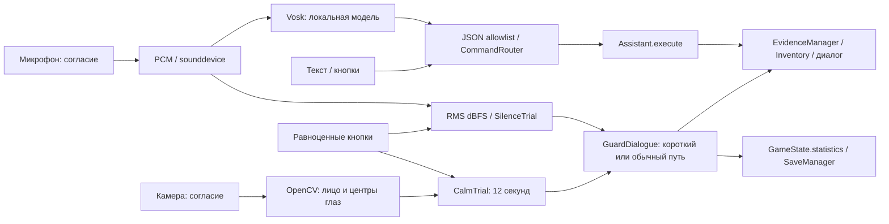

# ЛР №12 — AI Integration: описание модулей

Актуализация: **29.10.2026**, Asia/Qyzylorda. Реализованы локальный голосовой N.U.R.S., измерение шума и камерный эпизод охранника. Архитектура игры сохранена. Проверенные результаты и непроведённые натурные испытания разделены в [AI_Test_Results.md](AI_Test_Results.md).

## Установка и запуск

Обычная игра запускается через `run.bat` или `python main.py` с базовым `requirements.txt`. Необязательные сенсоры:

```powershell
python -m pip install -r requirements-ai.txt
python tools/download_voice_model.py
python main.py
```

В текущем окружении зависимости установлены через uv, поскольку в существующем venv нет pip:

```powershell
uv --cache-dir G:/bloody/.uv-cache pip install --python G:/bloody/.venv/Scripts/python.exe -r G:/bloody/bloody_trail/requirements-ai.txt
```

Проверенный набор: Python 3.12.14, Pygame 2.6.1, Vosk 0.3.45, sounddevice 0.5.1, NumPy 1.26.4, opencv-python 4.10.0.84. Модель `assets/models/vosk-model-small-ru-0.22` установлена, Apache-2.0; происхождение и SHA-256 записаны в `assets/models/voice_model_manifest.json`. Облако, платные API и сеть при игре не используются. Первый запуск без сенсорных пакетов или модели остаётся рабочим.

## AI №1 — голосовой N.U.R.S.

| Стадия | Реализация |
|---|---|
| Input | Нажать T (N также сохранена) в Exploration или T в кабинете, затем кнопку микрофона. Отдельное явное согласие на один запрос |
| Processing | sounddevice RawInputStream, mono PCM16 с частотой устройства → локальный Vosk → JSON-грамматика разрешённых фраз → CommandRouter |
| Output | Распознанный текст, intent или отказ; окно с ответом, инвентарь/карта/проверенные выводы |
| Game Logic | Assistant.execute вызывает существующий EvidenceManager; анализ не создаёт отсутствующие улики и не обходит условия финала |
| Ошибки | Нет пакета/модели/микрофона, занятое устройство, переполнение аудиопотока, неизвестная фраза, таймаут: понятный ответ и ручные действия |
| Отключение | Кнопка отключения, Esc, переход к другому экрану, потеря фокуса, завершение запроса или выход из игры |

Vosk — реальное акустическое распознавание, а не замена аудио заранее заданной строкой. JSON `src/data/voice_commands.json` задаёт словарь. Речь принимается только при точном совпадении нормализованной разрешённой фразы; `[unk]` никогда не выполняет действие. Текстовый ввод дополнительно использует существующий Naive Bayes для вариаций команд. Пример «сопоставь улики» оставлен текстовому классификатору, но исключён из голосовой грамматики: при проверке модель предупредила об отсутствии слова «сопоставь» в словаре.

| Команда | Intent | Действие и контекст |
|---|---|---|
| Покажи улики | evidence | Инвентарь только найденных материалов |
| Анализируй запись | analyze | Проверка собранных источников; если улик нет — объяснение вместо действия |
| Повтори показания | testimony | Повтор текста Анны только после получения `anna`; иначе предложение поговорить с ней в метро |
| Какие есть версии | versions | Уже подтверждённые основания из flags, без выдумывания новых подозреваемых |
| Сравни следы | analyze | EvidenceManager проверяет все необходимые основания; может открыть вывод/реплику/маршрут |

Распознавание ограничено девятью секундами после открытия потока. Модель загружается в отдельном процессе; пока она загружается, UI показывает соответствующий статус. Во время захвата виден «МИКРОФОН ВКЛЮЧЁН». По завершении поток закрывается. Никакого непрерывного прослушивания в фоне нет.

## Механика тишины

В метро подойти к охраннику справа и нажать E, затем «Пройти незамеченным — тишина». Тот же разговор доступен через hotspot журнала в Investigation.

PCM16 → RMS → `20 × log10(RMS / 32768)` dBFS. Это цифровая громкость, не физические децибелы SPL. После согласия первые две секунды предназначены для калибровки тихого фона; порог — медиана +12 dB, ограниченная диапазоном −50…−18 dBFS. Затем длится 12-секундный игровой эпизод.

Шум выше порога увеличивает опасность на 0,45/с, ниже — уменьшает на 0,12/с. Опасность 1 означает обнаружение; завершение времени без обнаружения — тихий проход. UI показывает шум, порог и опасность. Это измерение громкости, не отдельная ML-модель и не распознавание личности по голосу; ML в механике №1 обеспечивает Vosk.

Успех сохраняет `statistics.stealth_quiet = 1`: охранник сразу открывает короткую реплику к журналу. Неудача оставляет обычный разговор с дополнительным объяснением. Ключевая улика не теряется. Кнопочный режим использует тот же SilenceTrial: нажимать Space/«Идти тихо» не реже раза в две секунды. Устройства при этом не открываются.

## AI №2 — Camera Interaction

| Стадия | Реализация |
|---|---|
| Input | У охранника выбрать «Сохранять спокойствие», затем камеру и явное согласие на попытку |
| Processing | OpenCV VideoCapture → Haar face detection → Haar eye detection → два центра глаз как приближённые лицевые ориентиры → скорость их перемещения |
| Output | Одно лицо присутствует/нет, ориентиры надёжны/нет, нормированное движение; только числа передаются в UI |
| Game Logic | CalmTrial за 12 секунд формирует успех/неудачу → `statistics.guard_shortcut` → короткая или расширенная ветка GuardDialogue |
| Ошибки | Нет камеры, чтение кадра прервано, слишком старые данные, нет лица/глаз, несколько лиц, отсутствие OpenCV — отказ/ручной путь |
| Отключение | Кнопка остановки, Esc, потеря фокуса, перекрытие сцены, завершение 12 секунд, выход из игры |

Ориентиры здесь — **приближённые центры обнаруженных глаз**, а не плотная сетка MediaPipe. Для надёжного сигнала нужны ровно одно лицо и два достаточно разнесённых глаза. Скорость — среднее перемещение двух ориентиров, делённое на ширину лица и промежуток времени. Порог резкого движения — 0,65 ширины лица/секунду. Первое наблюдение после потери ориентиров не считается надёжным.

Успех: не менее 80% из 12 секунд получены свежие, надёжные, стабильные сигналы. Старые кадры не дают успеха; отсутствие свежих данных более трёх секунд отменяет попытку без штрафа. Сигнал не является определением эмоций, лжи, намерений или психологического состояния. Калибровка порога на живых пользователях ещё не проведена.

Кнопочный режим той же длительности использует CalmTrial: Space/«Сохранять спокойствие» раз в две секунды. Он открывает ту же короткую ветку. При неудаче игрок дважды выбирает обычное объяснение либо предъявляет уже найденное дело 2020. Журнал `transit` выдаётся через EvidenceManager; повторная выдача не приносит очков. Камерный сигнал сам не создаёт доказательства и не подтверждает виновность.

## Изоляция, хранение и приватность

`src/ai/devices.py`, `signals.py`, `commands.py` не импортируют Pygame и не меняют GameState. Input/Processing/Output изолированы от `src/scenes/sensors.py` и Assistant. Каждый захват работает в отдельном spawn-процессе с ограниченной очередью. Поток принадлежит дочернему процессу; при остановке он получает Event, а зависший процесс завершается. Драйвер не удерживает основной игровой цикл при чтении.

SceneManager вызывает on_cover/on_exit при push/pop/replace; quit также закрывает сенсоры. Потеря фокуса отменяет сенсорную попытку. Настройки согласия сохраняют предпочтение, но **не запускают** устройство и не заменяют согласие перед конкретной попыткой. Разрешения Windows не изменяются.

Аудиоблоки и кадры живут только в памяти дочернего процесса. На диск не записываются аудио, кадры и видео; серверу ничего не отправляется. Обычные сохранения v4 хранят только дискретные результаты и счётчики эпизодов внутри statistics, совместимые со старой схемой; raw-сигналы туда не попадают. В экспериментальном CLI в JSON явно сохраняются распознанные тестовые команды и числовые результаты после отдельного согласия, но не записи устройств.



## Основные файлы и источники

- `src/ai/devices.py`: реальный захват, Vosk и процессная изоляция; `src/ai/signals.py`: RMS, лицо/глаза и оценка эпизодов; `src/ai/commands.py`: маршрутизация.
- `src/scenes/sensors.py`: согласие, охранник, сенсорный/ручной UI; `src/scenes/overlays.py`: голосовой N.U.R.S.; `src/core/scene_manager.py`: освобождение устройств.
- `tools/lab12_content.py`: охранник и журнал в существующей карте; включён в цепочку генерации стартовых данных. Не запускать полную генерацию поверх собственных правок JSON без намерения их заменить.
- `tests/test_lab12.py`, `tools/lab12_experiments.py`: автоматические проверки и воспроизводимый натурный протокол.

Техническая основа: [официальный пример Vosk + sounddevice](https://github.com/alphacep/vosk-api/blob/master/python/example/test_microphone.py), [модели Vosk](https://alphacephei.com/vosk/models), [OpenCV: обнаружение лица и глаз каскадами](https://docs.opencv.org/4.x/db/d28/tutorial_cascade_classifier.html). Эти источники описывают технологии; показатели качества Bloody Trail должны подтверждаться собственными экспериментами.
