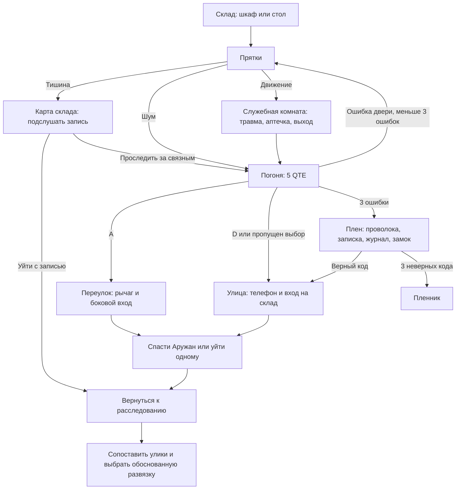

# Bloody Trail RC4 — Hide & Survive, погоня и последствия

Дата: 30.10.2026. Продолжение существующей игры; новый эпизод подключён к порту и диалогу Сарсенова. Старые расследования, голосовые команды N.U.R.S., камера охранника, QTE и концовки сохранены.

## Что доступно игроку

В порту подойдите к «Склад 07 / след связного» и нажмите E. Альтернатива: разговор с Сарсеновым → «Склад 07 / последствия». На отдельной карте склада можно выбрать шкаф или стол. WASD/стрелки — движение, E — взаимодействие, T — контекстная подсказка Нурса.

Перед прятками выберите клавиши, микрофон либо микрофон+камеру. Сенсоры требуют явного согласия на попытку; настройки не включают устройства автоматически. Камера и микрофон работают одновременно в отдельных процессах. Esc/пауза, потеря фокуса, выход, смена сцены и ошибка прекращают захват. Во время захвата игровой звук отключён, чтобы собственные эффекты игры не повышали шум.

В режиме клавиш удерживайте SPACE и не нажимайте направления. Это равноценная альтернатива: все пять развязок достижимы без оборудования. При использовании только микрофона неподвижность проверяется по клавишам направления. Отказ от сенсоров не выдаёт штрафа; можно продолжить с сохранёнными временем попытки и опасностью.

## Прятки

15 секунд надёжного сигнала / кнопочного управления. Перед сенсорной попыткой — 2 секунды калибровки. Из PCM вычисляется RMS/dBFS существующим модулем; калибровка оценивает фоновый уровень, добавляет запас к порогу. Чувствительность шума и движения: 50–150%. Показания сглаживаются; краткий шумовой импульс не приводит к мгновенному обнаружению. Опасность накапливается только после превышения порога в течение допуска и уменьшается при тишине.

Камера: OpenCV Haar определяет одно лицо, затем sparse optical flow измеряет движение текстурных точек в приблизительной области головы/плеч/рук. Изменения глобальной яркости и заметное общее смещение фона помечаются ненадёжными. При потере лица/сигнала таймер и штраф останавливаются; после 8 секунд без надёжных данных устройства отключаются и предлагается ручной режим.

Это сигнал движения, не распознавание эмоций, лжи или психологического состояния. Это также не полноценная модель скелета: руки вне области лица/верхней части тела не отслеживаются. Локальное движение фона внутри выбранной области может мешать; реальные условия требуют проверки (см. AI_Experiments.md).

Есть шкалы шума/движения/опасности, индикаторы активных устройств, комментарии преследователя, движение его тени, временная анимация укрытия, сердцебиение, шаги, дверь, затемнение краёв и небольшая дрожь при опасности. Эффекты соблюдают настройку уменьшения движения. Графика и эффекты созданы кодом; внешние ресурсы не добавлялись.

## Погоня

Пять последовательных QTE:
1. SPACE — перепрыгнуть забор (одиночное нажатие).
2. A/D — выбрать переулок или улицу (направление).
3. E × 3 — закрыть дверь (отдельные нажатия с отпусканием).
4. SHIFT — удерживать 0,9 секунды (ускорение).
5. F — оттолкнуть преследователя.

Настройки: 3 секунды, 6 секунд, без таймера. Травма уменьшает стандартное окно до 2,55 секунды; доступные режимы не ухудшаются. Между действиями есть отдельная анимационная пауза. Автоповтор/удержание предыдущей клавиши не выполняет следующий шаг. Сохраняются результат каждого QTE и выбранное направление. При загрузке незаконченного шага его таймер начинается заново; уже завершённые шаги не повторяются.

## Игровые ветки

При повторном обнаружении шумом Никиту захватывают. После обыска и травмы, если погоня уже закончилась, можно выйти через служебную лестницу на улицу — сюжет не зацикливается.

Успех пряток даёт новую запись встречи, которую необходимо забрать у окна. Травма уменьшает скорость до перевязки; факт ранения остаётся в журнале. Плен — отдельная управляемая комната: искать проволоку и записку, прочитать журнал похитителей, ввести код. Ошибка не отнимает ключевые прежние улики. Отказ помочь Аружан требует отдельного подтверждения и приводит к её гибели; спасённая Аружан появляется в порту, погибшая отсутствует в метро. Реакции в диалогах учитывают спасение/похищение.

## Пять новых развязок

| Концовка | Проверяемые условия |
|---|---|
| Правда раскрыта | Эпизод завершён; полная доказательная цепочка, предъявленная Сарсенову; передана копия; Аружан не погибла |
| Ложное обвинение | Эпизод завершён; цепочка неполна; игрок явно подтверждает обвинение Айдоса |
| Пленник | Никита захвачен, инструменты найдены, три ошибки при открытии замка камеры |
| Цена правды | Полная предъявленная цепочка и резервная копия, но игрок оставил Аружан погибать |
| Скрытая правда | Успех пряток, запись встречи, флешка из книги и карточка сейфа, подсказка T после записи, все пять QTE без ошибок, спасение Аружан, полная предъявленная цепочка и резервная копия |

Выбор новых развязок: «Развязки нового эпизода» у Сарсенова либо кнопка новых развязок после предъявления цепочки. Каждая имеет собственный экран, реплику/портрет, оформление и итог. Секрет раскрывает сохранённую советом Helios копию Сигмы; это не отменяет ответственность Сарсенова. Старые финалы не удалены.

## Архитектура и сохранения

- `StealthSystem`, `QTESystem`: числовые сигналы и правила, без Pygame/оборудования. Общий QTE-движок подключён и к прежним испытаниям двери/архива; их последовательности и последствия сохранены.
- `MotionDetector`: кадр → достоверность/движение; нет файлов и сетевых запросов.
- Существующий `SensorSession`: процессы Input; в Pygame передаются только числовые признаки, не видео.
- `StoryManager`: единый журнал последствий, ветка, травма, отношения, результаты QTE.
- `ending_allowed`: детерминированные условия; интерфейс не выдаёт концовку без проверки.
- `GameState.thriller` и SaveManager v8: текущая ветка, позиция в комнате, найденные предметы, решения, прогресс пряток, QTE, концовка. Поддержаны старые v1–v7. При загрузке сенсоры выключены и согласие запрашивается заново.
- JSON: комнаты, QTE, тексты концовок, новые улики. Доска и инвентарь получили страницы для материалов сверх 16.

## Проверки и ограничения

163 автоматический тест PASS: 128 прежних и 35 новых. Полный список — `tests/test_thriller.py`; журнал — `docs/thriller/tests.log`. Проверены все пять развязок, четыре ветки, возвращение из плена, повторные прятки, коллизии/достижимость объектов, защита от повтора клавиши, сохранения, миграция, отказ оборудования, одновременная обработка сигналов, фотометрические ограничения на синтетических кадрах.

`source_runtime.json` проверяет реальное окно Windows, голосовую модель на синтетической тишине, OpenCV на пустом кадре и полный новый эпизод на кнопках до секретной концовки. Предшествующая кампания в этом runtime-тесте задаётся подготовленным набором доказательств; это не человеческое прохождение всей игры. Тесты прежней кампании отдельно проходят её обновлённые предметные действия.

Живой микрофон, реальное лицо/руки, различные комнаты/освещение и качество звука на слух в этом этапе НЕ проверялись. Нет фиктивной accuracy или пользовательских отзывов. Временная пиксельная графика и простые анимации требуют художественной доработки. Игра не сохраняет сырые аудио/видеоданные и не использует платные сервисы.

## Зависимости и запуск

Новых пакетов не устанавливалось: уже присутствуют pygame 2.6.1, NumPy 1.26.4, OpenCV 4.10.0.84, sounddevice 0.5.1, Vosk 0.3.45; сборщик PyInstaller 6.16.0. Версии проверены через installed metadata. Базовый режим клавиш не требует сенсорных библиотек.

Исходники: `G:\bloody\.venv\Scripts\python.exe G:\bloody\bloody_trail\main.py`.
При установке в новое Python-окружение: `python -m pip install -r requirements.txt`, сенсоры дополнительно `python -m pip install -r requirements-ai.txt`.
Windows: распаковать `BloodyTrail-Windows-x64-RC4.zip` целиком; открыть `BloodyTrail.exe`. Python на целевой машине не требуется.

Дополнительно проверены потеря фокуса через реальный обработчик игрового цикла и отсчёт QTE по фактически прошедшему времени кадра. Alt+Tab ставит погоню на паузу и сбрасывает удерживаемые клавиши.

Финальная проверка собранного RC4 EXE завершилась с кодом 0: Windows-окно, загрузка модели Vosk, OpenCV, сохранение/загрузка, доступ к полной версии и новый эпизод до секретной концовки — PASS. Машиночитаемый результат: packaged_runtime.json. Физические устройства не открывались. Для быстрого показа подготовлен Demo_thriller.cmd → Продолжить; отдельное демонстрационное сохранение не заменяет личный прогресс.
